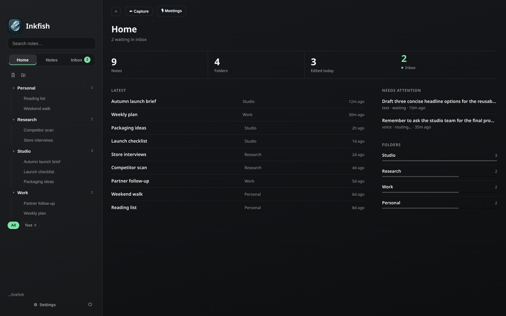

# Inkfish

Menu-bar quick capture for macOS. Hit ⌥Space, dump the thought, and Inkfish files it into the right project note later. Notes are plain markdown in a folder you own.

[](https://github.com/PylotLight/Inkfish/releases/latest)
[](#install)
[](LICENSE)
[](https://github.com/PylotLight/Inkfish/actions/workflows/ci.yml)



<sub>Home, from an earlier version (the sidebar and toolbar have changed since). All notes shown are made up.</sub>

## Install

Apple silicon Macs only, macOS 12 or newer.

**Homebrew**

```bash
brew tap pylotlight/inkfish https://github.com/PylotLight/Inkfish.git
brew install --cask inkfish
```

**DMG or zip:** grab `Inkfish-<version>-mac-arm64.dmg` (or `.zip`) from the [latest release](https://github.com/PylotLight/Inkfish/releases/latest) and drag **Inkfish.app** to Applications.

**No install, with bunx** (or npx):

```bash
bunx @pylotlight/inkfish
```

Downloads the release zip once, checks its SHA-256, caches it in `~/.cache/inkfish` and opens it. Later runs open the cached copy instantly. `bunx @pylotlight/inkfish --uninstall` removes it again. Details in [packages/cli](packages/cli/README.md).

### "Inkfish is damaged and can't be opened"

Builds aren't signed or notarized yet, so macOS quarantines the download and shows that message. The app is fine. Click Cancel (don't move it to the Bin), then:

```bash
xattr -cr /Applications/Inkfish.app
```

and open it again. The bunx launcher doesn't hit this.

Inkfish checks GitHub Releases and tells you when there's a new version (Settings → About & updates).

## What it does

**Capture**
- ⌥Space anywhere opens a small capture window near the cursor. Type, paste or drop images, dictate, and ⌘↩ saves to the inbox. ⇧⌥Space appends to today's daily note instead.
- Lives in the menu bar: left-click the icon to capture, right-click for the menu. Menu bar mode can hide the Dock icon, change what a click opens (capture, today, or the main window), or turn the icon off (Settings → Appearance → Menu bar).
- Voice notes transcribe on-device: Apple Speech, SpeechAnalyzer (macOS 26), or downloadable Parakeet / Nemotron / Cohere models on the Neural Engine, with a built-in benchmark to pick one (Settings → Voice Engine).

**Inbox to project notes**
- Captures sit in the inbox, then get cleaned up and filed into a top-level folder (`work/`, `personal/`, …) with a title and tags. Raw captures are kept, and a wrong pick can be undone or reassigned.
- Sorting runs on rules out of the box. Turn on Apple Intelligence (on-device, macOS 26) or connect your own provider: Anthropic or any OpenAI-compatible server (OpenAI, Ollama, LM Studio, LiteLLM).
- Per-note AI actions: tidy formatting, fix typos, summarise, turn into a checklist, or a custom instruction. Raw / Split / Processed views leave the file untouched until you apply the result (one ⌘Z undoes it). Works on a selection too.

**Meetings**
- Record a call as a two-speaker transcript: your mic is "Me", the Mac's audio is "Them", with live captions. Pick system audio from specific apps (just Teams, not your music).
- Saved as a filed meeting note. Teams `.vtt` transcripts can be imported too.

**Notes**
- Live-preview markdown editor (CodeMirror) with tabs, pinning, in-note find, code highlighting and autosave.
- Images: paste or drop to save into `assets/`, drag to resize (Obsidian-style `` widths), drag to move, right-click to copy.
- File names follow the note's `# title` until you rename a file by hand. Click the header title to rename in place; links and `[[wikilinks]]` to the note are updated (Settings → Notes → Name files from title).
- Sidebar file tree with drag and drop, Move to…, tag chips and a breadcrumb. Hover a row to rename or delete; delete shows a glance of the note first and can be undone. Deleted notes stay in Settings → Trash for 7 days.
- Today: a daily note with quick-append from the Home dashboard, the tray, or ⇧⌥Space.
- ⌘K command palette (commands, notes, `#tags`) and ⌘O note switcher.

**Mini windows**
- ⇧⌘M pops a note out into a small always-on-top window that floats over full-screen apps and every Space. Tuck it to the screen edge behind a handle, snap it to a corner, set its opacity. Up to 6 at once, kept in sync with the main window. ⌃⌥M shows or hides them all.

**Android companion + sync**
- The Android app (`android/`) captures, browses and edits the same notes. Pair it with a QR code (Settings → Sync) and it syncs with the Mac over your local network, end-to-end encrypted, no server. Big deletions ask before they apply.

**Looks:** glass (vibrancy) window, themes and accent colours, font choices including the bundled Libron.

## Your data

- **Notes:** a plain folder of `.md` files, `~/Inkfish` by default (you pick it on first launch, and an existing Obsidian vault works). Inkfish only writes finished notes and `assets/` there. Change it in Settings (Notes home).
- **App data:** `~/Library/Application Support/Inkfish` holds settings, the search index (a cache, rebuilt from your files by Rescan), raw inbox captures, the daily-log scratch and trash.
- Your AI API key and phone pairing keys are encrypted with the macOS keychain. With no AI provider connected, notes only go to a phone you paired. With one, note text also goes to the provider you configured.

## Uninstall

- Homebrew: `brew uninstall --cask inkfish` (add `--zap` to also remove app data).
- bunx: `bunx @pylotlight/inkfish --uninstall`, or `--purge` to also remove app data. See [packages/cli](packages/cli/README.md#uninstall).
- Either way your notes folder is left alone.

## Docs

- [Troubleshooting](docs/troubleshooting.md)
- [Sync design](docs/sync.md) · [On-device AI](docs/intelligence.md) · [Speech-to-text engines](docs/stt-options.md)

## Development

Bun + Electron + React + TypeScript. Building from source, the dev profile, tests, architecture and releasing: [DEVELOPING.md](DEVELOPING.md).

## License

[MIT](LICENSE)
